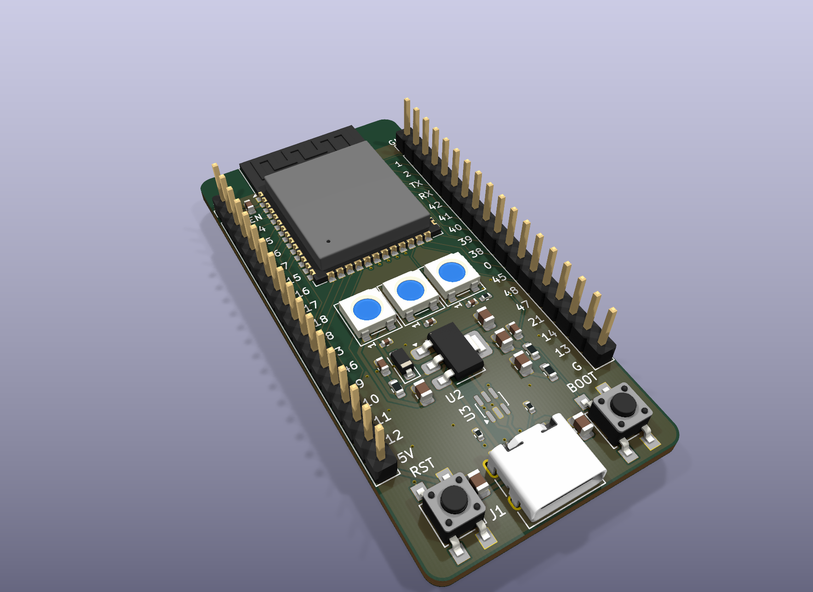
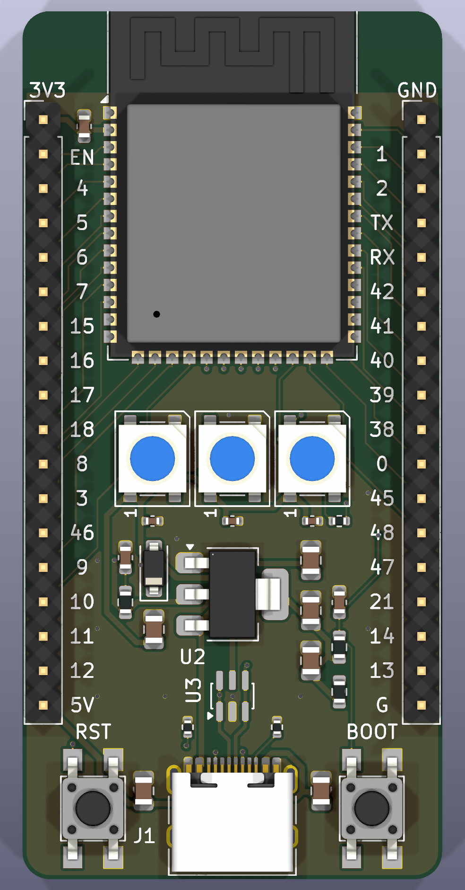

# ESP32-S3 DevKit

A 31 × 64 mm ESP32-S3 development board laid out like Espressif's DevKitC-1: the WROOM-1 module at the top with its antenna on the edge, an 18-pin header down each side, three WS2812B LEDs, and USB-C between RST and BOOT.

An agent built it through [HeyPCB's MCP server](https://heypcb.ai/mcp): blocks, parts, nets, hand placement, routing and checks, all as tool calls. KiCad 10 opens the files directly, and the board is on [Circuit World](https://heypcb.ai/world/b/a0fca22e9815) to open or fork in HeyPCB (sign-in required).

  

  

## What's on it

- **ESP32-S3-WROOM-1-N8R8** (8 MB flash, 8 MB octal PSRAM). IO35–IO37 go to the PSRAM, so they are not broken out.
- **USB-C** (HRO TYPE-C-31-M-12) wired to the chip's native USB on IO19/IO20, through a **USBLC6-2SC6** ESD array, with 5.1 kΩ pull-downs on CC1 and CC2.
- **AMS1117-3.3** regulator, 5 V from USB to 3.3 V.
- **Three WS2812B LEDs** chained from IO48 through a 330 Ω resistor, powered from 5 V through a 1N5819W Schottky.
- **RST** pulls EN low and **BOOT** pulls IO0 low, with 10 kΩ pull-ups to 3.3 V and 100 nF to ground.
- **4 layers** on JLCPCB's 4-layer rules. In1 is a solid ground plane; the other three layers carry signals with ground poured around them.

Every part has an LCSC number in the BOM.

## Pinout

Headers are 2.54 mm pitch, 27.94 mm (1.1 in) between rows. Pin 1 is at the antenna end on both sides.

| Pin | Left (J2) | Right (J3) |
|---:|---|---|
| 1 | 3V3 | GND |
| 2 | EN (reset) | IO1 |
| 3 | IO4 | IO2 |
| 4 | IO5 | TXD0 |
| 5 | IO6 | RXD0 |
| 6 | IO7 | IO42 |
| 7 | IO15 | IO41 |
| 8 | IO16 | IO40 |
| 9 | IO17 | IO39 |
| 10 | IO18 | IO38 |
| 11 | IO8 | IO0 (BOOT) |
| 12 | IO3 | IO45 |
| 13 | IO46 | IO48 (LED data) |
| 14 | IO9 | IO47 |
| 15 | IO10 | IO21 |
| 16 | IO11 | IO14 |
| 17 | IO12 | IO13 |
| 18 | 5V (USB VBUS) | GND |

## Checks

Measured on this revision:

| Check | Result |
|---|---|
| DRC, HeyPCB | 0 errors, 0 unconnected |
| DRC, KiCad 10.0.6 run locally | 0 errors, 0 unconnected |
| ERC | 0 errors |
| HeyPCB verify (DRC, ERC, artwork copper, electrical rules, simulation, IR drop, physical, DFM, placement, thermal) | all 10 pass |
| Fab readiness (JLCPCB) | ready to order, 14 checks passed |

Warnings the board still carries:

- **USB pair skew is 1.45 mm against a 1.25 mm rule.** USB_DP measures 47.73 mm and USB_DN 46.28 mm. The rule comes from the USB 2.0 preset; the ESP32-S3's USB is full speed (12 Mbps). The two lines run side by side on the bottom layer, but they are not a tightly coupled pair.
- VBUS can peak at 540 mA while HeyPCB budgets 500 mA for J1, so it suggests about 290 µF more bulk capacitance near the connector.
- The regulator's input and output capacitors sit 9–10 mm from its pins: inside the limit, flagged as marginal.
- The antenna reaches free space at the top edge, but HeyPCB notes the side edges, and their ground pour, run close beside it.
- The module's ground pad has no thermal vias.
- No fiducials. J1 is a JLCPCB Extended part (a $3 feeder fee).
- A few silkscreen clearance nits.

## Files

| Path | What it is |
|---|---|
| `esp32-s3-devkit.kicad_pro`, `.kicad_sch`, `.kicad_pcb` | The KiCad 10 project |
| `heypcb-libs/` | The one footprint not in KiCad's standard library (USBLC6-2SC6, SOT-23-6), wired up by `fp-lib-table` |
| `design.json` | The HeyPCB design the schematic and board are generated from |
| `fab/` | Gerbers and drill files, BOM and pick-and-place (CPL) for JLCPCB assembly |
| `images/` | KiCad 3D renders |

## License

MIT. See [LICENSE](LICENSE).
